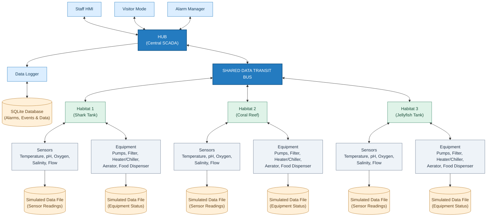
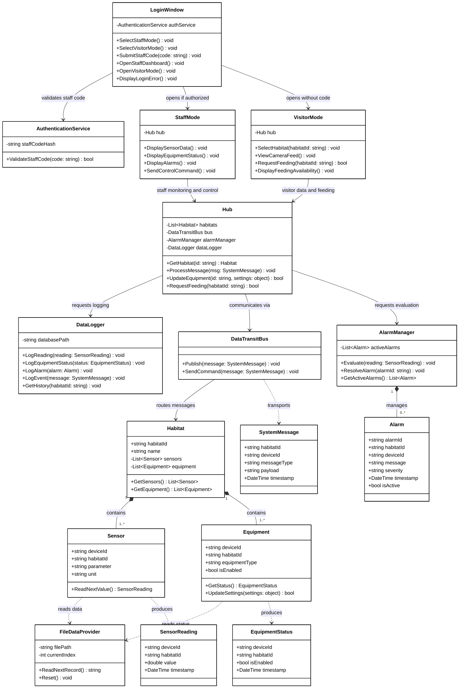

# AquaGuard

AquaGuard is a SCADA/HMI aquarium management system developed for our Project III: Software Development Life Cycle course at Conestoga College.

The system is designed to monitor aquarium habitat conditions, manage life-support equipment, alert staff to unsafe conditions, and log important system data.

## Features

AquaGuard is planned to include:

- Real-time habitat monitoring
- Graphical HMI for aquarium staff
- Warning and alarm system
- Equipment monitoring and control
- Simulated device data
- SQLite data logging
- Multiple aquarium habitats
- Visitor Mode for viewing aquarium habitats

## Monitoring

The system will monitor devices and conditions such as:

- Temperature
- Dissolved oxygen
- pH
- Salinity
- Water flow
- Circulation pumps
- Filtration systems
- Heater/Chiller
- Aerators
- Food dispensers

## Staff Controls

Through the AquaGuard HMI, staff will be able to control and configure aquarium equipment, including:

- Circulation pumps
- Filtration systems
- Heater/Chiller
- Aerators
- Food dispensers

## System Design

AquaGuard uses a central Hub to coordinate communication between the HMI, aquarium habitats, monitoring devices, controllable equipment, alarm system, and data logger.

Each habitat is composed of the sensors and equipment required to monitor and maintain its environment.

## Data Logging

AquaGuard will use SQLite to store important system information such as:

- Sensor readings
- Warnings and alarms
- Equipment activity
- Control changes
- System events

## Testing

The project will use both automated and manual testing.

Automated testing will focus on device logic, simulated data processing, alarms, equipment controls, Hub communication, and data logging.

Manual testing will focus on the HMI, navigation, staff controls, warning displays, Visitor Mode, and overall usability.

## Technologies

- C#
- .NET
- SQLite
- Git / GitHub
- Visual Studio

## System Architecture

The following diagram illustrates AquaGuard's system architecture, including the central Hub, shared Data Transit Bus, aquarium habitats, simulated devices, alarm management, and SQLite data logging.

## Class Diagram

The UML class diagram presents AquaGuard’s main classes, attributes, methods, and relationships. It illustrates how the login system, Staff and Visitor Modes, and central Hub interact with the monitoring, control, alarm management, and data logging components, following a modular design based on SOLID principles.

## Project Team

**Group 7**  
CSCN72030 - Project III: Software Development Life Cycle  
Conestoga College
